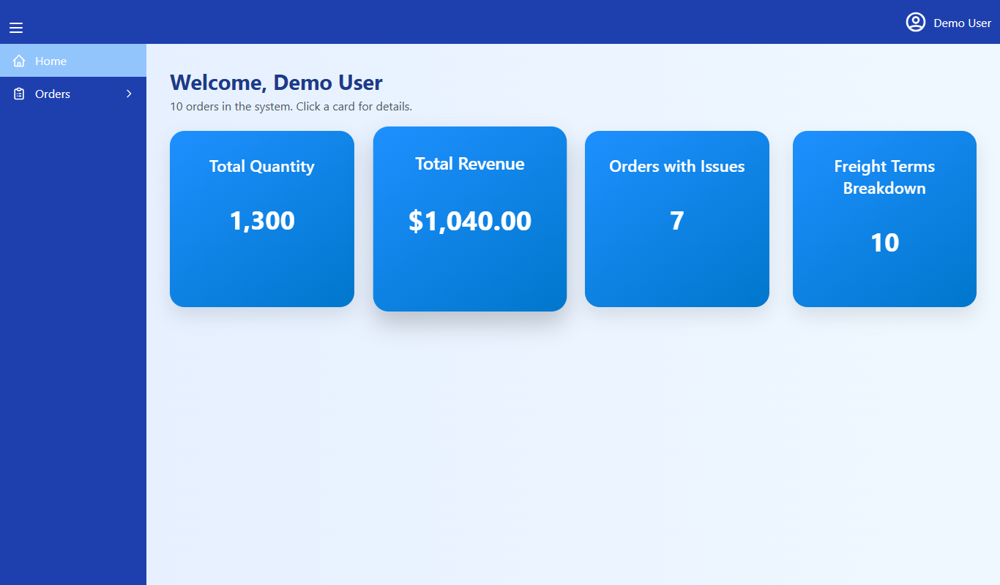
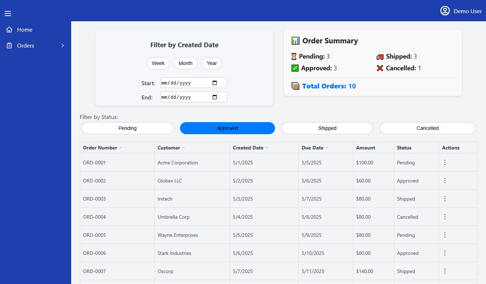

# OrderDesk – Order Management App


A React dashboard for creating, tracking and reviewing customer orders. Built as a front-end assessment and later cleaned up and moved to Vite.



## Features

- **Login, register and reset password** (stored in the browser), with a one-click demo account
- **Dashboard** with total quantity, total revenue, orders with issues and freight terms, each with a detail view
- **Create orders** with validation, Incoterm or Freight Terms choice, reason codes and multiple order lines with live totals
- **Order list** with status filters, date range filters (week / month / year or custom), sorting, and view, history and delete actions
- **Profile** with editable name, email, phone and photo
- Responsive layout with a collapsible sidebar



## Tech stack

React 18 · Vite · React Router 6 · Ant Design · Context API · localStorage

## Run locally

```bash
npm install
npm run dev
```

Open the URL Vite prints and click **Use demo account** (demo@orderdesk.app / demo123).

## Project structure

```
src/
  components/   Sidebar layout, OrderContext (state + persistence)
  pages/        Home, CreateOrder, DisplayOrdersList, Login, Register, ResetPassword
  styles/       Page styles
  utils/        Date and money formatting helpers
public/
  data.json     Sample orders loaded on first visit
```

## Notes

All data lives in the browser's localStorage, so there is no backend to set up. Sample orders come from `public/data.json`, and orders you create are saved on top of them.
